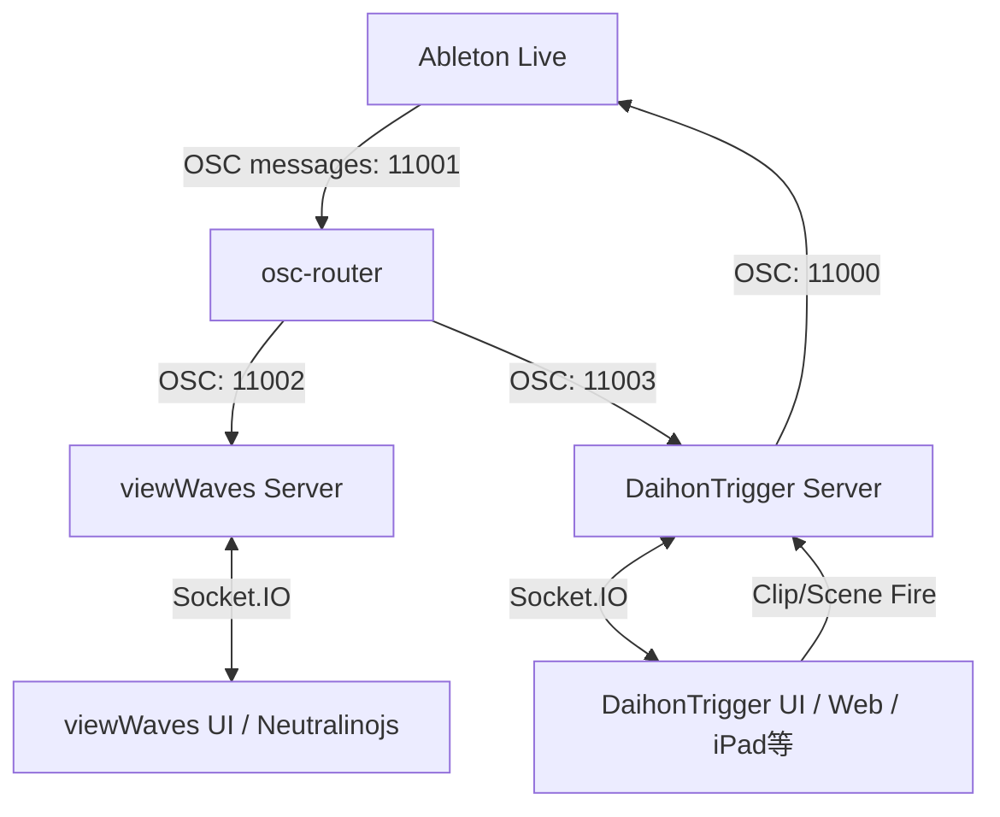

# AbletonOSC_Suite 分析・品質評価レポート (/kaizen)

本システムは、Ableton Live と OSC 通信を用いて連携し、ライブや演劇などの現場での音響・映像制御を支援するためのスイートツールです。
以下に、システムの全体構造、および本番環境（特に安定性が求められる現場）で運用した際に想定される不具合・リスクと改善案を報告します。

---

## 1. システム全体構造とコンポーネント

*   **`osc-router`**: Ableton Live からの単一の OSC 送信を複製し、各受信ポートへ転送する中継器。
*   **`viewWaves`**: Neutralinojs を使用した波形ビューワー。ダブルバッファリング (A/B 面) による音声プリロードと、自前のストップウォッチ方式（ローカル補間）による滑らかな再生位置表示が特徴。
*   **`DaihonTrigger`**: 同一 LAN 内の iPad 等からアクセス可能な Web ベースの台本表示兼クリップ・シーン発火アプリ。

---

## 2. 想定される不具合の可能性とリスク

### A. OSC（UDP）のパケットロスによる同期漏れ（重大度：高）
*   **事象**: OSC 通信は UDP を使用しているため、ネットワークの混雑時にパケットロスが発生します。
*   **リスク**: 
    *   `viewWaves` で再生が検知された直後の `file_path` や `length` などの初期データ取得パケットが脱落すると、波形がロードされず、その後のポーリング処理（`setInterval`）で再要求が成功するまで表示が遅れます。
    *   `viewWaves` 側では 0.5秒ごとにポーリングで補完していますが、プロジェクトが巨大（多数（トラック・スロット））になると OSC 送受信量が急増し、かえって遅延やネットワーク詰まりを引き起こす原因になります。

### B. `DaihonTrigger` のセッションデータ取得（同期同期）処理のタイムアウト（重大度：中〜高）
*   **事象**: `DaihonTrigger` の `get_session_data` (ライン212-266) は、全トラック、全シーン、そして**全クリップの名称**を同期的にループ処理で1つずつ OSC リクエストを投げて待機（`await queryOsc`）しています。
*   **リスク**:
    *   例えば「10トラック×100シーン = 1000個のスロット」があるプロジェクトの場合、1000回以上の OSC トランザクションが**直列で実行**されます。
    *   タイムアウトが 1000ms に設定されているため、応答がないスロットが複数あると全体の同期完了まで数分以上かかり、事実上フリーズ状態（またはタイムアウトによる一部データの欠落）に陥ります。

### C. クライアント切断に伴うサーバーの自動シャットダウン仕様（重大度：中）
*   **事象**: `viewWaves` の `server.js` は、接続クライアント（UI画面）が 0 になってから 5秒経過すると `process.exit(0)` でプロセスを自動終了させます (ライン353-365)。
*   **リスク**:
    *   本番中やリハーサル中に、一時的な Wi-Fi 切断、ブラウザの再読み込み、または iPad のブラウザがバックグラウンドに移行したことで WebSocket コネクションが数秒切れた場合、バックエンドサーバーが自動終了してしまいます。
    *   サーバー終了後は UI 側でリロードしても復帰せず、手動でのアプリ再起動が必要になります。

### D. ポート重複時の動作不良と強制終了（重大度：中）
*   **事象**: `viewWaves` はポート競合時（ポート 3000 が使用中など）に、親プロセスを `SIGKILL` して自身も終了します (ライン430)。`DaihonTrigger` はポート競合時のハンドリングがなく、単にクラッシュします。
*   **リスク**:
    *   他アプリ（あるいは前回のゾンビプロセス）がポートを掴んでいた場合、アプリがエラーダイアログなどを出さずにサイレントに起動失敗（または落ちる）するため、トラブルシューティングが困難です。

### E. セキュリティ認証の欠如による誤操作リスク（重大度：低〜中）
*   **事象**: `DaihonTrigger` は同一 LAN 内から自由にアクセスできますが、認証やアクセス制御（トークン等）がありません。
*   **リスク**:
    *   リハーサル現場や本番の同一 Wi-Fi に接続している他のデバイスから、誤って（あるいは故意に）`/upload-pdf` で台本が上書きされたり、本番中に任意のタイミングでクリップ発火コマンドが送られてしまうリスクがあります。

### F. クロスプラットフォーム運用時の絶対パス問題（重大度：低）
*   **事象**: `/audio?path=...` API を通じて Ableton Live が持つオーディオファイルを読み込みますが、これは Ableton とビューワーが同一 PC 内で動作していることを前提としています。
*   **リスク**:
    *   Ableton Live を Mac で動かし、ビューワーを Windows で動かすなど、別マシンでクロスプラットフォーム運用をする場合、Mac の絶対パス（`/Users/...`）が Windows 側に渡されてもファイルをロードできず、波形が表示されません。

---

## 3. 推奨される改善案 (Kaizen)

1.  **直列ループ同期の非同期化・バッチ化 (DaihonTrigger)**:
    *   `get_session_data` におけるクリップ名の取得を `Promise.all` 等を利用して並行処理化するか、あるいは AbletonOSC 側でサポートされていれば一括取得用のカスタム API の利用を検討してください。
2.  **自動シャットダウン条件の緩和 (viewWaves)**:
    *   クライアント接続数 0 でのシャットダウンは、Neutralinojs の親プロセスが終了した場合（標準入力の `end` イベント）のみに限定し、WebSocket の一時的な切断ではサーバーを終了させない設計にすることを推奨します。
3.  **ポートの動的割り当てと競合検知**:
    *   ポート競合が発生した場合は、自動で空きポートを探して起動し、そのポート情報をフロントエンドに渡す仕組み、またはユーザーに競合が発生している旨を伝えるエラー表示を実装すると親切です。
4.  **簡易認証の実装 (DaihonTrigger)**:
    *   LAN 内の別デバイスからの誤操作を防ぐため、接続時に簡易的なパスコード（クエリパラメータやセッション等）を設定できるようにすることを推奨します。
